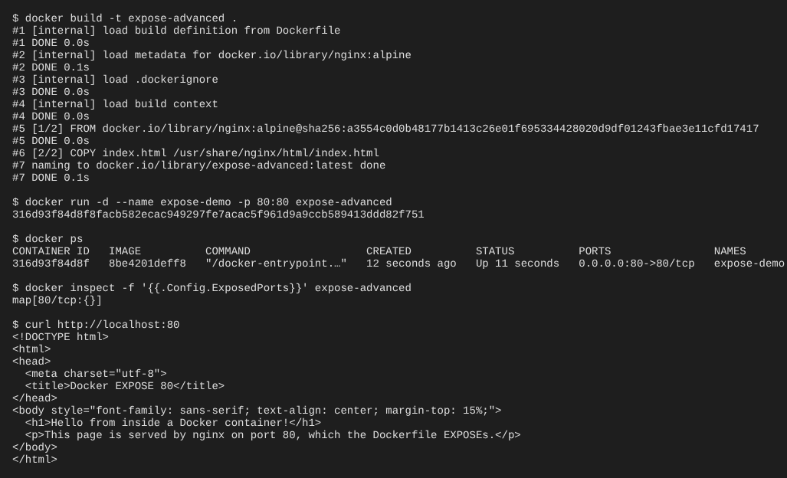
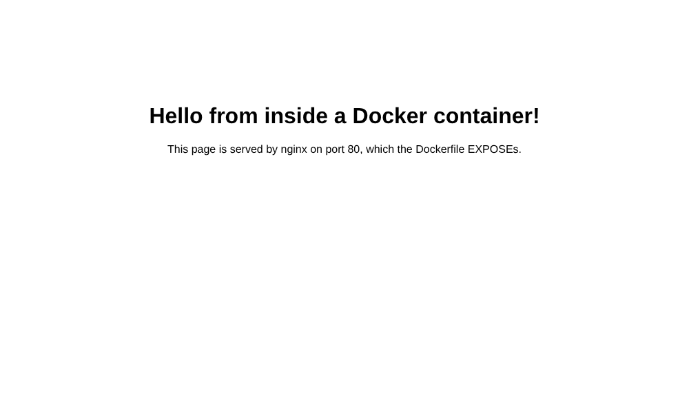

# Docker EXPOSE (Advanced): serving a file on port 80

The [basic EXPOSE example](../Dokerfile) only declares port 80 on an Ubuntu image; nothing listens on it.
This example puts a real web server behind that port and serves an HTML file from it.

## Files

**Dockerfile**
```
FROM nginx:alpine
COPY index.html /usr/share/nginx/html/index.html
EXPOSE 80
```
* `FROM nginx:alpine` - a small image with the nginx web server, which listens on port 80.
* `COPY index.html ...` - replaces nginx's default page with our own [index.html](index.html).
* `EXPOSE 80` - documents that the container listens on port 80.

## How EXPOSE works

`EXPOSE` does **not** open the port to your machine by itself. It is metadata on the image
that says "this container listens on port 80". You can see it with:
```
$ docker inspect -f '{{.Config.ExposedPorts}}' expose-advanced
map[80/tcp:{}]
```
To reach the port from the host you must **publish** it when running the container:
* `-p 80:80` - map host port 80 to container port 80 (`-p <host>:<container>`).
* `-P` - publish every EXPOSEd port to a random free host port (see it with `docker ps`).

## Steps

1. Build the image (from this folder)
```
$ docker build -t expose-advanced .
```

2. Run the container and publish port 80
```
$ docker run -d --name expose-demo -p 80:80 expose-advanced
```

3. Check it is running and the port mapping `0.0.0.0:80->80/tcp`
```
$ docker ps
```

4. Open http://localhost:80 in a browser, or:
```
$ curl http://localhost:80
```

5. Clean up
```
$ docker rm -f expose-demo
```

## Screenshots

Terminal: build, run, port mapping, exposed port and the page fetched with curl



Browser at http://localhost:80


